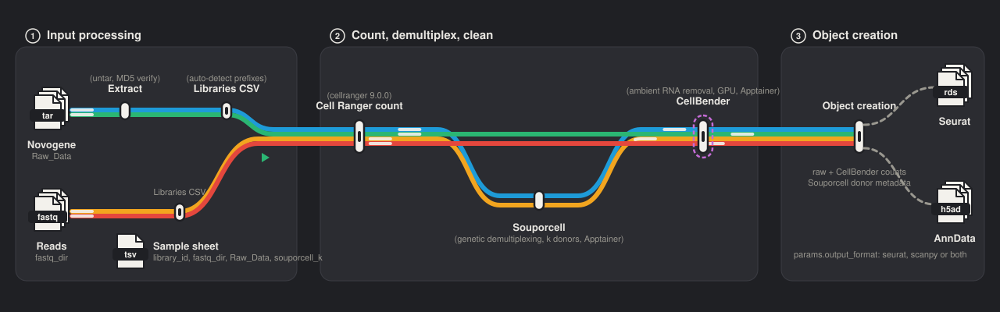
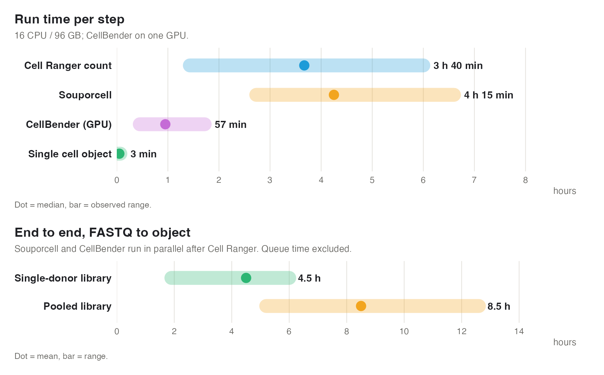

# xRAFT-scRNA: 10x-express RAw FASTQ To single-cell RNA-seq objects

# Project information:

    

---

## General Description

**Author:** Kristian Gurashi (kristian.gurashi@gmail.com)

**Pipeline:** xRAFT-scRNA: 10x-express RAw FASTQ To single-cell RNA-seq objects

**Scope:** 10x Genomics single-cell RNA-seq, from raw sequencing archives to analysis-ready Seurat (R) and AnnData (Scanpy, Python) objects

Nextflow DSL2 pipeline that takes scRNA-seq data from raw sequencing archives (for example as delivered by Novogene) or existing FASTQs to analysis-ready single-cell objects, in one unattended run on a Slurm cluster. It covers FASTQ extraction, Cell Ranger count, Souporcell genetic demultiplexing for pooled libraries, CellBender ambient-RNA removal, and object creation for either ecosystem: a Seurat object (`.rds`) for R or an AnnData object (`.h5ad`) for Scanpy, or both. Every object is validated against its inputs before the run finishes, and Nextflow `-resume` means a failed or extended run picks up where it stopped.

**Why?** Every 10x project begins with the same manual stage: extract and verify archives, run Cell Ranger, remove ambient RNA, demultiplex pooled donors, build an object. Done by hand it is slow, inconsistent and not reproducible. nf-core/scrnaseq skips archive extraction and genetic demultiplexing; xRAFT-scRNA runs exactly these steps from one command and one sample sheet, and returns the same object every time, in R or Python.

## Graphical Workflow

<p align="center">
  
</p>

Four lines show the combinations the sample sheet allows: raw archives or existing FASTQs, pooled or single-donor libraries. Filled stations run by default; hollow stations (Extract, Souporcell) run only when the sample sheet asks for them. The terminal station writes a Seurat `.rds`, an AnnData `.h5ad`, or both, according to `params.output_format`.

## Content

One subworkflow per step in `subworkflows/`:

| Step | Subworkflow | Runs when |
| --- | --- | --- |
| 1. Extract FASTQs from tar archives (e.g. Novogene), with MD5 verification | `extraction.nf` | `Raw_Data` is set |
| 2. Build the Cell Ranger libraries CSV (auto-detects FASTQ prefixes) | `cellranger_libraries.nf` | always |
| 3. Cell Ranger count | `cellranger_count.nf` | always |
| 4. Souporcell genetic demultiplexing | `souporcell.nf` | `souporcell_k > 1` |
| 5. CellBender ambient-RNA removal (GPU) | `cellbender.nf` | always |
| 6. Seurat object (`RNA` assay with `counts`, `RNA_raw_counts` and `RNA_cellbender_counts` layers, Souporcell metadata) | `create_seurat_object.nf` | `output_format` is `seurat` or `both` |
| 7. AnnData object (`RNA_raw_counts` and `RNA_cellbender_counts` layers, Souporcell metadata) | `create_anndata_object.nf` | `output_format` is `scanpy` or `both` |
| 8. Validate objects: structure, counts vs Cell Ranger, Souporcell and metadata columns, and R/Python agreement | `validate_outputs.nf` | always |

## Run time

Measured with Slurm accounting over 20 runs on the lab cluster (16 CPUs, 96 GB for Cell Ranger and Souporcell; 4 CPUs, 24 GB, one GPU for CellBender). Queue time excluded.

<p align="center">
  
</p>

**End to end:** a single-donor library in about 4.5 h, a pooled library in about 8.5 h (range 5 to 12.5 h, n = 10). Libraries run in parallel: eight pooled libraries finished overnight, in 13 h.

## How to run it

You need three things: your sequencing data on the cluster, a sample sheet, and one command.

**1. Put your data where the pipeline can see it.** Copy the tar archives from the sequencing provider (for example Novogene) into a folder on the cluster, or point to a folder that already holds FASTQ files.

**2. Fill in the sample sheet.** Open `data/sample_sheet.csv` in Excel or a text editor. One row per library, four required columns:

| Column | What to write | Example |
| --- | --- | --- |
| `library_id` | A name for the library (the same name as its folder inside the archive) | `EGO_12` |
| `fastq_dir` | Where the FASTQs should go, or already are | `/data/fastq/EGO_12` |
| `Raw_Data` | The archive file(s) to extract, separated by `;`. Leave empty if your FASTQs already exist | `/data/raw/EGO_12.tar` |
| `souporcell_k` | How many donors were pooled in this library. Write `1` or leave empty if it is a single donor | `4` |

Any extra columns you add (for example `experiment` or `batch_10x`) are copied into the final object as per-cell metadata (Seurat `meta.data` / AnnData `obs`), one column each.

**3. Choose your output.** In `nextflow.config`, set `params.output_format` to `seurat` (R), `scanpy` (Python) or `both`. Everything else in that file is set up for the lab cluster; you only need to touch it if you want results in a different folder.

**4. Run.** From the pipeline folder:

```bash
./start_pipeline.sh
```

(It creates `slurm/` and `run/` if needed and submits itself with `sbatch`; Slurm needs `slurm/` to exist before the job starts, so plain `sbatch start_pipeline.sh` only works once that directory is there.)

Then log off. The pipeline queues every step on Slurm, runs the libraries in parallel and finishes on its own; a pooled library takes around 8 hours, so a batch is usually ready the next morning.

You can also start it from the console instead of through Slurm — Nextflow only coordinates, the work still runs as Slurm jobs. Always launch from `run/` so `-resume` finds its cache and use `-bg` so the coordinator survives logout:

```bash
module load nextflow/25.04.7
cd run && nextflow run ../main.nf -resume -w ../work -bg
tail -f .nextflow.log
```

Use `sbatch start_pipeline.sh` instead if your login node kills long-running processes. Both share `run/` and `work/`, so either can resume the other's run.

`start_pipeline.sh` also runs a watchdog: if Nextflow's Slurm task monitor goes silent for 90 min while the process is still alive (a blocked `squeue` call can freeze it indefinitely — it happened once with 14 jobs in flight), it kills Nextflow and relaunches with `-resume`, up to five times. Finished tasks are cached, so a relaunch costs nothing; the event is logged as `[WATCHDOG]` in the Slurm job output. The executor polling intervals in `nextflow.config` are set conservatively for the same reason.

**5. Collect your objects.** Each library gets its own folder with the finished object, ready to load:

- Seurat: `<seurat_results>/<library_id>/<library_id>_seurat.rds`
- AnnData: `<anndata_results>/<library_id>/<library_id>.h5ad`

The objects hold raw and CellBender-corrected counts (Seurat v5: one `RNA` assay with `RNA_raw_counts` and `RNA_cellbender_counts` layers; AnnData: `X`/`layers["RNA_raw_counts"]` and `layers["RNA_cellbender_counts"]`), the Souporcell status and donor assignment for pooled libraries, and your sample-sheet columns, so analysis can start straight away.

**If something goes wrong,** submit the same command again. Nextflow's `-resume` reuses every step that already finished and only reruns what is missing (the resume cache lives in `run/`, so keep that folder). If Nextflow reports `Can't open cache DB`, the launcher moves that cache aside (`run/.nextflow/cache.broken.<date>`) and relaunches with a fresh one; already-finished steps are then recomputed once. The per-step logs are in `logs/` (`01_Extract_raw_data.log` … `08_Validation.log`), and `reports/pipeline_report.html` shows what ran and how long it took. To force a step to rerun, delete its entry from `work/` or run with `-resume` removed.

**Validation.** Step 8 fails the run if an object is wrong: every layer must have the Cell Ranger barcodes and features in order, raw counts must sum to the Cell Ranger matrix, CellBender counts must be ≤ raw counts cell-by-cell, Souporcell columns must match `clusters.tsv`, every sample-sheet column must be present with one value, and when both formats are built the `.rds` and `.h5ad` must agree on all of it. The report is `logs/08_Validation.log`.

## Tests

`tests/run_tests.sh` exercises the object-creation scripts and the validators on a synthetic Cell Ranger / CellBender / Souporcell input set (a few hundred cells, built in seconds) for a pooled and a single-donor library, then checks that the Seurat and AnnData objects agree. It covers the awkward cases: barcodes present in Cell Ranger but not CellBender, extra CellBender barcodes, duplicated gene symbols, cells missing from `clusters.tsv`, and empty sample-sheet fields.

```bash
tests/run_tests.sh                 # in the pipeline containers (pulled into containers/ if missing)
tests/run_tests.sh --local         # with python3 / Rscript on PATH
tests/run_tests.sh --python-only   # AnnData side only
```

Run it after editing anything under `modules/create_*_object/` or `modules/validate/`.

## Directory layout

```
main.nf  nextflow.config  start_pipeline.sh  tidy_pipeline_dir.sh
modules/  subworkflows/  data/  docs/  tests/
containers/   pulled SIFs named by tag (cellbender_0.3.2.sif …) + their .manifest files
resources/    common-variants VCF and other references
run/          Nextflow launch dir: resume cache, .nextflow.log*
work/         Nextflow work dir
logs/         merged per-step logs 01..08
reports/      Nextflow HTML report, timeline, trace
slurm/        Slurm job logs (<job>.<id>.out/.err) and slurm/sps/ profiling dumps
```

`tidy_pipeline_dir.sh` moves any `Report-*.out/.err`, `*.out/*.err`, `sps-*.tar.gz` and `.nextflow.log*` left at the top level by earlier runs into `slurm/`, `slurm/sps/` and `run/`, and writes a manifest for any SIF that predates them.

## Container versions

The four images are pinned to numbered tags in `nextflow.config` (`cellbender:0.3.2`, `cumulusprod/souporcell:2021.03`, `satijalab/seurat:5.5.1`, `gcfntnu/scanpy:1.12.3`). The SIF file name carries the tag (`containers/seurat_5.5.1.sif`), so changing a tag pulls a new file rather than reusing the old one, and each pull writes `containers/<name>.sif.manifest` recording the registry digest behind the tag:

```
IMAGE=docker://satijalab/seurat:5.5.1
PULLED=2026-10-19 16:02:11
IMAGE_DIGEST=sha256:048d965487afc2961c450879692281a73e24f6de47360ed2f11b31112ebd844e
IMAGE_DIGEST_SHORT=048d965487af
SIF=seurat_5.5.1.sif
SIF_SHA256=…
HUB_URL=https://hub.docker.com/layers/satijalab/seurat/5.5.1/images/sha256-048d965487af…
```

`IMAGE_DIGEST` is the registry digest shown on the image's Docker Hub page, and the manifests are committed to git (everything else in `containers/` is ignored), so git history records exactly which build each run used. To move to a newer version, change the tag in `nextflow.config` and rerun; the old SIF stays in `containers/` until you delete it. Don't use `:latest` — it moves, and `-resume` cannot tell. SIFs pulled before manifests existed get one with `IMAGE_DIGEST=unknown` via `tidy_pipeline_dir.sh`.

Why these versions: CellBender 0.3.2 and the Souporcell 2021.03 build (commit `1bd9f11`, Souporcell 2.4, minimap2 2.7, freebayes 1.3.1, vartrix 1.1.16) are what the run-time benchmarks above were measured with; Seurat 5.5.1 and Scanpy 1.12.3 were the current releases when the object steps were written. CellBender 0.4.0, Souporcell 2.5 (`cumulusprod/souporcell:2.5`) and Souporcell 3.0 (`library://wheaton5/souporcell/souporcell:release`) exist; treat a bump as a change to validate on one library first.

## Dependencies

| Component | Version | Used for |
| --- | --- | --- |
| Nextflow | 25.04 or later, Slurm executor | Workflow engine |
| Cell Ranger | 9.0 or later | Alignment and counting |
| Apptainer or Singularity | any recent | Containers for Souporcell, CellBender, Seurat and Scanpy |
| CellBender | container, GPU | Ambient-RNA removal |
| Souporcell | container | Genetic demultiplexing of pooled libraries |
| Seurat | container (`satijalab/seurat`, pulled once by the pipeline) | Seurat object output and validation |
| Python 3 | any, on the cluster PATH (standard library only) | R/Python agreement check |
| Scanpy | container (`gcfntnu/scanpy`, pulled once by the pipeline) | AnnData object output and validation |
| References | Cell Ranger transcriptome, reference FASTA, common-variants VCF | Counting and Souporcell |

Module names are set in `start_pipeline.sh` and `nextflow.config`; container images and bind mounts are `params.cellbender_container`, `params.souporcell_container`, `params.seurat_container`, `params.scanpy_container` and `params.container_binds`. Result directories and references live in [nextflow.config](nextflow.config) (`params.samplesheet`, `params.cellranger_results`, `params.souporcell_results`, `params.cellbender_results`, `params.seurat_results`, `params.anndata_results`, `params.transcriptome`, `params.ref_fasta`, `params.common_variants`, `params.logs_dir`); map the Slurm labels `basic`, `extract`, `build`, `long` and `gpu` to your partitions. The wrapper launches Nextflow from `run/` with `-resume` and `-w work/`; extra arguments are passed through (`sbatch start_pipeline.sh --output_format scanpy`). `nextflow run main.nf -resume` from a fixed directory works too.

---

# Networking:

[](https://www.linkedin.com/in/kristiangurashi/) [](https://github.com/EspressoKris)